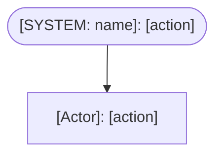

# Process Map: [process-name] (To-Be)

**State:** To-be (future state after the proposed change)
**Process owner:** [role accountable for this process — if unresolved, record "unresolved — see assumption-log [ASMP-xxx]"]
**Confidence:** [omit this line if evidence-derived | add `[LOW CONFIDENCE — AS-IS USER-STATED]` if current-state claims are user-stated | add `[NEW WORKFLOW — NO PRIOR AS-IS STATE]` if entirely new]
**Change scope reference:** [link to change-scope item that drives this process change]
**As-is process map:** [link to discovery process map, if available — "N/A: discovery was skipped" if not]

**Trigger:** [What starts this process]
**Terminal outcomes:** [Success outcome] | [Failure outcome(s)]
**Actors:** [List all actors involved in the to-be process]
**Shared information:** [Information this process reads or writes]

**Volume / Frequency / Peak period:** [e.g., "~500 transactions/day; peaks Friday PM" — or "unknown — see assumption-log [ASMP-xxx]"]
**Target performance metrics:** [cycle time targets, throughput rates, error rate thresholds from constraint register — or "not defined"]

---

## Steps

| # | Actor | Action | Change Label | SLA / Timing Constraint | Notes |
|---|-------|--------|-------------|------------------------|-------|
| 1 | [role or `[SYSTEM: name]`] | [verb-object phrase a business stakeholder would recognise] | [NEW] / [MODIFIED] / [UNCHANGED] | [from constraint register, or "none"] | [exception path, conditional logic, or low-confidence flag] |

> Step-level `[LOW CONFIDENCE — USER-STATED]` annotations: apply to individual steps where the basis is user input rather than a discovery artifact.

---

## To-Be Happy Path (Mermaid)

> System-actor nodes use rounded-rectangle syntax `([text])`. Human-actor steps use standard rectangles `[text]`. Removed steps are absent from this diagram — they appear only in the Change Delta table.

---

## Business Rules

Every decision node in the flowchart above must reference a Rule ID from this table.

| Rule ID | Status | Decision Node (Step #) | Condition | Path if True | Path if False |
|---------|--------|------------------------|-----------|--------------|---------------|
| BR-001 | [NEW / MODIFIED / UNCHANGED] | Step [N] — [decision label] | [condition — e.g., "Order value > $10,000"] | [path A] | [path B] |

---

## Handoff Summary

Every actor-to-actor transition must appear here. A flowchart arrow is not a handoff record.

| Handoff # | From | To | Content | Format | Timing | Channel |
|-----------|------|----|---------|--------|--------|---------|
| HO-001 | [role] | [role or `[SYSTEM: name]`] | [what is transferred] | [form / email / system notification / signed PDF] | [by when] | [email / internal portal / system queue / in-person] |

> Unknown attributes: record as "unknown" and log an assumption.

---

## Change Delta

| Change Type | Step # | Description | Driving Requirement | Capability Disposition (REMOVED only) |
|------------|--------|-------------|---------------------|--------------------------------------|
| NEW | | | [REQ-xxx] | N/A |
| MODIFIED | | [what changed and what drives it; for decision nodes, record prior rule and replacement rule] | [REQ-xxx] | N/A |
| REMOVED | (former step) | [what was removed and why] | [REQ-xxx or "N/A — [explain]"] | [Absorbed by step [N] — describe how / Retired — explain why / Deferred to [phase] — by whom] |

---

## Constraint Validation

| Constraint | Affected Step(s) | Compliance Status |
|-----------|-----------------|-------------------|
| [CON-xxx: description] | | [Compliant / Violation — waiver logged in decision-log [DEC-xxx] / Violation — blocker logged in decision-log [DEC-xxx]] |

---

## Persona Linkage

| Persona | Step(s) | Interaction |
|---------|---------|-------------|
| | | Input provided / output received |

> If fully automated: record `[FULLY AUTOMATED — NO HUMAN TOUCHPOINTS — NO USER JOURNEY GENERATED]` at the top of this section and leave the table empty.
