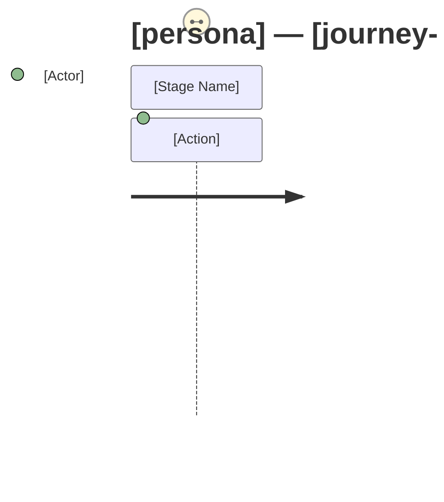

# User Journey Map: [persona] — [journey-name] (To-Be)

**State:** To-be (future state after the proposed change)
**Persona:** [Persona name and role]
**Journey goal:** [What the user wants to accomplish]
**Business importance:** Frequency: [sourced value or ASMP-xxx] | Volume: [sourced value or ASMP-xxx] | Criticality: [Critical / Significant / Supporting]
**Change scope reference:** [link to change-scope item that drives this journey change]
**As-is journey map:** [link to discovery journey map, if available — "N/A: discovery was skipped" if not]
**Process map reference:** [link to to-be process map this journey rides on]

---

## Journey Stages

### [Stage Name] [NEW] / [MODIFIED] / [UNCHANGED]

**User goal:** "I want to..."
**Touchpoints:** [Pages, screens, notifications, emails the user interacts with — name specifically, not "the form" but "the Order Submission form on the Checkout page"]
**Action:** [What the user does — specific and observable: "clicks 'Submit'", "enters email address"]
**System response:** [What the user sees or receives in response — include timing threshold: "confirmation displayed within 3 seconds; beyond this, user uncertainty increases" — source from constraint register or business stakeholder; log as assumption if unknown. If response is invisible to user, state that explicitly.]
**Anticipated friction:**
- [Friction point] — Severity: High / Medium / Low
**Satisfaction indicator:** [Positive / Neutral / Negative / Blocked] — [brief basis: what drives this rating. If discovery was skipped, do not record "Positive" — record "Neutral" at best and note "no baseline — improvement assessment not applicable".]
**Business-critical flag:** [Critical / Significant / Supporting] — [brief rationale; must be consistent with overall journey criticality]
**Process map step(s):** [Which to-be process steps this stage corresponds to — e.g., PM-03]

---

## To-Be Journey Diagram (Mermaid)

---

## Change Delta

| Change Type | Stage | Description | Driving Requirement |
|------------|-------|-------------|---------------------|
| NEW | | | [REQ-xxx] |
| MODIFIED | | | [REQ-xxx] |
| REMOVED | (former stage) | [what was removed and why] | [REQ-xxx or "N/A — [explain]"] |
| IMPROVED | | [Which existing friction point is resolved, and how] | [REQ-xxx] |

---

## Anticipated Friction Summary

| Stage | Friction Point | Severity | Mitigation |
|-------|---------------|----------|------------|
| | | High / Medium / Low | |

---

## Stakeholder Validation Record

| Stakeholder | Role | Date Validated | Corrections Made |
|------------|------|---------------|----------------|
| [name] | [role] | [date] | [summary of corrections, or "None"] |

> If stakeholder was unavailable, record: "Unavailable — logged as assumption [ASMP-xxx]. Friction ratings are provisional."

---

## Cross-Persona Consistency Check

| Hand-off Point | Producing Persona / Stage | Consuming Persona / Stage | Consistent? | Issue (if any) |
|---------------|--------------------------|--------------------------|-------------|---------------|
| | | | [Yes / No / Unresolved after 2 cycles — see ASMP-xxx] | |
