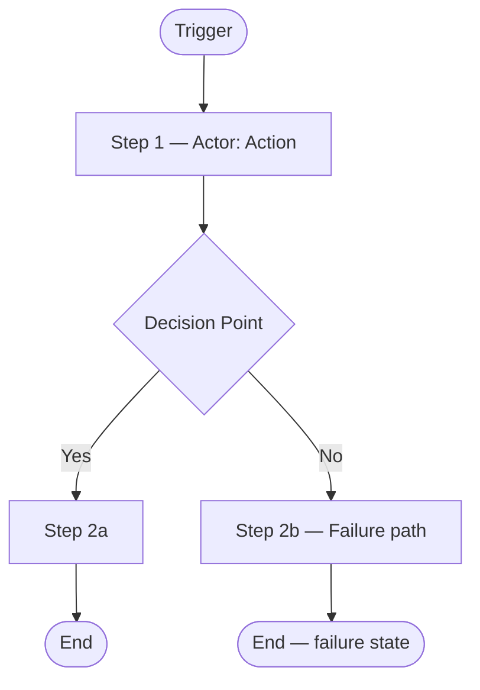

# Process Map

> **Process name:** [name — e.g., "Order Checkout", "User Onboarding", "Invoice Approval"]
> **State:** As-is (current state)
> **Project:** [project name]
> **Proposed change:** [brief description of the feature or change request]
> **Process owner:** [role or team responsible for this process]
> **Date mapped:** [date]
> **Source:** [how this process was confirmed — e.g., observed in the system, described in existing documentation, stakeholder walkthrough; cite the specific document or observation]

---

## Trigger

What initiates this process?

> [Describe the event or condition that starts the process — e.g., "User submits the checkout form", "Nightly scheduled process runs", "Notification received from payment provider"]

## Actors / Swimlanes

| Swimlane | Actor | Description |
|----------|-------|-------------|
| 1 | [e.g., Customer] | [brief description of their role in this process] |
| 2 | [e.g., System] | |
| 3 | [e.g., Payment Service] | |

*Add or remove swimlanes as needed. Use the minimum number that shows the handoffs clearly.*

---

## Process Steps

| # | Actor | Action | System Response | Decision Point | Handoff To |
|---|-------|--------|-----------------|---------------|------------|
| 1 | [actor] | [active verb + object — e.g., "Submits order form"] | [what the system does in response] | [condition and branches if applicable] | [next actor receiving control or information] |
| 2 | | | | | |

*For decision points, describe both the success and failure branch. Do not leave failure paths blank.*

---

## Inputs and Outputs

**Inputs** — information or materials this process uses at its start:
- [input — e.g., "Cart contents (items, quantities, prices)", "Verified user identity"]

**Outputs** — information or results this process produces on completion:
- [output — e.g., "Order record created", "Confirmation sent to customer", "Inventory updated"]

---

## Failure and Exception Paths

| Step # | Failure Condition | What Happens | Resolved by the System? |
|--------|-----------------|--------------|-----------------|
| [step] | [e.g., "Payment provider does not respond in time"] | [e.g., "Order placed in a pending state; user shown option to retry"] | [Yes / No / Partially — cite source] |

---

## Diagram

*Replace with the actual steps. Add swimlane boundaries using subgraph if useful.*

---

## Pain Points

Existing inefficiencies observed in the current process — not things to fix now, but things the new feature must not worsen and may have an opportunity to improve.

| # | Step | Pain Point | Type | Source |
|---|------|-----------|------|----------|
| 1 | [step #] | [description] | [bottleneck / manual workaround / missing failure handling / duplication / other] | [observation, document reference, or stakeholder input] |

---

## Gaps

Steps the process clearly must include but that could not be confirmed from available sources. These become targeted questions for stakeholder input.

| # | Expected Step | What Is Unknown | Question to Resolve |
|---|--------------|----------------|----------------------|
| 1 | [what step should exist] | [what has not been confirmed] | [question to ask the business or stakeholder] |

---

## Connected Systems

External services or internal capabilities this process interacts with.

| System / Capability | Connection Type | Direction | Notes |
|----------------|-----------------|-----------|-------|
| [e.g., Payment service] | [real-time exchange / scheduled transfer / notification / shared information] | [inbound / outbound / both] | [e.g., "synchronous exchange — failure behavior not yet confirmed"] |

---

## Linked User Journeys

Which user personas interact with this process and at which steps?

| Persona | Interacts At Step(s) | From Their Perspective |
|---------|---------------------|----------------------|
| [persona name] | [step numbers] | [what they see or do] |

---

## Relevance to Proposed Change

| Step # | Relevance | Notes |
|--------|-----------|-------|
| [step] | [Directly affected / Indirectly affected / Unrelated] | [brief explanation] |

**Summary:** [1–2 sentences on how the proposed change interacts with this process overall]
