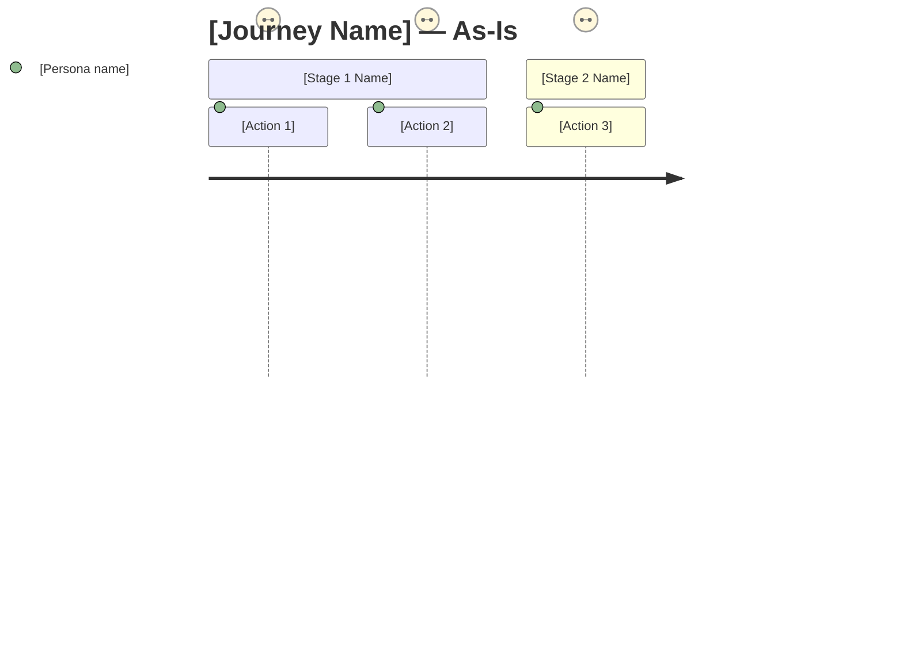

# User Journey Map

> **Persona:** [persona name — e.g., "Customer", "Admin", "First-time User", "Returning Subscriber"]
> **Journey:** [journey name — e.g., "Complete Checkout", "Onboard to the Product", "Manage Team Members"]
> **State:** As-is
> **Project:** [project name]
> **Proposed change:** [brief description of the feature or change request]
> **Date mapped:** [date]
> **Source:** [how this journey was confirmed — e.g., observed in the system, described in existing documentation, stakeholder walkthrough; cite the specific document or observation]

---

## Persona Summary

| Field | Value |
|-------|-------|
| **Who they are** | [brief description — role, context, how frequently they use the system] |
| **Primary goal** | [what they ultimately want to achieve with this product] |
| **Key characteristic** | [one thing that makes their experience distinct from other personas] |
| **How they are known to the system** | [how this persona is represented — e.g., distinct role, dedicated area of the application, conditionally available functionality] |

---

## Journey Stages

*Score 1–5 represents experience quality: 1 = highly frustrated, 3 = neutral, 5 = delighted. Replace sections and actions with actual journey stages.*

---

## Stage Detail

### Stage [N]: [Stage Name]

> **User's goal at this stage:** [I want to... — written from the user's perspective]

| Field | Detail |
|-------|--------|
| **Touchpoints** | [pages, screens, emails, notifications the user encounters] |
| **Actions** | [what the user does — specific and observable] |
| **System response** | [what the system does in response — from the user's visible perspective] |
| **Satisfaction score** | [1–5: 1 = highly frustrated, 2 = frustrated, 3 = neutral, 4 = satisfied, 5 = delighted — must match score used in the diagram above; note basis: confirmed through observation or stakeholder input] |
| **Pain points** | [friction, confusion, or frustration — cite source; rate each High / Medium / Low] |

---

*Repeat the Stage Detail block above for each stage in the journey.*

---

## Journey Gaps

Aspects of the journey that cannot be confirmed from available sources and require stakeholder input.

| # | Stage | What Is Unknown | Current Assumption | Question to Resolve | Priority |
|---|-------|----------------|----------------------|----------------------|----------|
| 1 | [stage name] | [what has not been confirmed] | [the assumption being made in the interim] | [question to ask the business or stakeholder] | [Critical / Important / Nice-to-know] |

---

## Pain Point Summary

Consolidated list of current friction points.

> **Severity guide:** High = blocks the user from completing the task; Medium = slows completion or causes confusion but a workaround exists; Low = minor friction with no meaningful impact on task success.

| # | Stage | Pain Point | Severity |
|---|-------|-----------|----------|
| 1 | [stage] | [description] | [High / Medium / Low] |

---

## Linked Process Maps

| Process Map | Relationship |
|-------------|-------------|
| [process name] | [this journey is supported by this process — reference the process-map document] |

---
