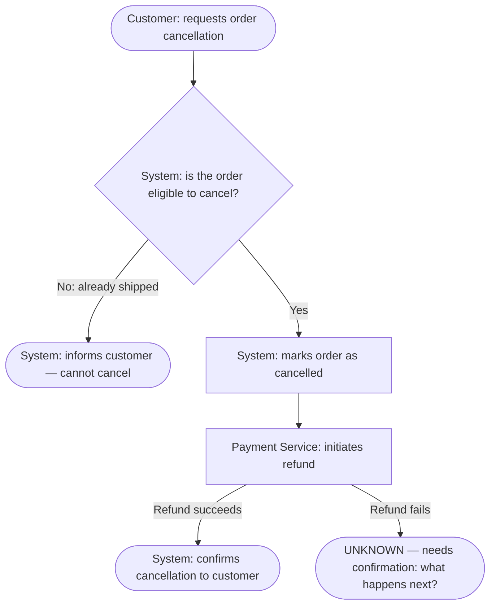

# Process Mapping

## Purpose

Model current-state (as-is) processes using swimlane diagrams or BPMN. Captures actors, steps, decision points, handoffs, and system interactions for all workflows affected by the proposed change. Future-state mapping is out of scope for discovery — it is produced in analysis after requirements are defined.

## Definitions

**Process:** A named, bounded sequence of steps that begins with a specific trigger, ends with a specific terminal outcome (success or failure), involves at least one actor, and produces or transforms at least one piece of business information. A process is distinct from a sub-process (a contained sequence within a larger process) and from a step (a single atomic action within a process). When in doubt about granularity, a process should be nameable as a verb phrase with a clear start and end — e.g., "Submit order", "Approve expense claim", "Provision user account."

**As-is:** The process as it is currently implemented and demonstrably active in the system and live documentation. Inactive features and partially implemented flows are **not** as-is — they are gaps. Map what is demonstrably active; label ambiguous sections explicitly as `[UNKNOWN — needs confirmation]`.

**Complete (for a process map):** A process-map entry is complete when every step has a named actor, an active verb, and a specified outcome; every decision point has both a success and failure branch; and every gap or unknown is explicitly labeled rather than silently omitted.

**`[UNKNOWN — needs confirmation]`:** A step that demonstrably must exist in the process (because surrounding system behaviour or business logic requires it), but whose specifics cannot be determined from the system or existing documentation alone. The step is included in the map with this label; its behaviour must be confirmed with a stakeholder before requirements are written.

**`[GAP — not found]`:** A step that business logic or domain knowledge implies should be present, but for which no evidence exists in the system or documentation. This may indicate a missing feature, an undocumented manual workaround, or something removed without documentation. Every `[GAP]` becomes a direct input to requirements-elicitation.

**Distinguishing `[UNKNOWN]` from `[GAP]`:** Ask: *Does surrounding system behaviour or business logic in this specific system require this step to exist?* If yes — a preceding step produces output that must go somewhere, a decision branch must have a resolution, a trigger must have a handler — use `[UNKNOWN — needs confirmation]`. If the step is implied only by general domain convention or best practice, not by anything specific in this system's behaviour, use `[GAP — not found]`. When genuinely unsure, prefer `[UNKNOWN — needs confirmation]` and confirm with a stakeholder rather than asserting a gap that may simply be an undocumented feature.

## When to Use

- The proposed change touches or modifies a workflow — not just a simple data update invisible to users
- Stakeholder consultation will be needed to resolve process unknowns — process maps give those conversations a precise, shared structure instead of relying on verbal descriptions
- The system handles multi-actor workflows with handoffs, approvals, or branching conditions

## What This Produces

**As-is process maps** for every workflow relevant to the proposed change. The as-is map is the output for discovery. To-be maps are produced after requirements are defined — do not attempt future-state mapping during discovery.

## What This Is Not

- **Not a system architecture diagram** — that is architect territory
- **Not a user journey map** — process maps show the system/operational view (actors, steps, handoffs); user-journey-mapping shows the user experience view (goals, emotions, pain points). Both are needed; they complement each other
- **Not a requirements document** — process maps describe current state; requirements describe desired future state

## Inputs

| Input | Source | Required |
|-------|--------|----------|
| Current capability inventory | codebase-discovery output | Yes — identifies what workflows exist |
| Documentation currency assessment | existing-artifact-review output artifact (the formal assessment) | Yes — indicates which process docs are current vs. stale; determines whether existing docs can be trusted |
| Proposed change description | `docs/<feature>/requirements-package/discovery/change-description.md` | Yes — determines which processes to map (Step 1 only). The change description is not used in any subsequent step to determine what those processes do. All process step content is derived exclusively from the capability inventory and existing documentation. |
| Existing process documentation | Source materials surfaced by existing-artifact-review (flowcharts, runbooks, specs) | If available — the actual documents; the AI validates their content against the capability inventory to confirm they reflect what the system actually does |

> **Missing input guard:** If an expected input file cannot be found at its documented path, do not silently skip it. Inform the user: *"I expected [artifact name] at `[full path]` but it was not found. This input is [required/recommended] for this skill. Should I proceed without it, or can you provide it?"*

## Workflow

```
┌──────────────────────────────────────────────────┐
│  1. IDENTIFY — Which processes to map            │
│     Use capability inventory + change request    │
│     to select affected workflows.                │
├──────────────────────────────────────────────────┤
│  2. DERIVE — AI builds the map from system       │
│     knowledge (internal step)                    │
│     Actors and steps derived from the            │
│     capability inventory before asking the       │
│     BA/PO to explain anything.                   │
│                                                  │
│     ↻ If >30% of steps are unresolvable,         │
│       present partial map, consult BA/PO to      │
│       fill gaps, then continue to Step 3.        │
├──────────────────────────────────────────────────┤
│  3. STRUCTURE — Define swimlanes                 │
│     Assign each actor a swimlane: users,         │
│     system, external parties.                    │
├──────────────────────────────────────────────────┤
│  4. TRACE — Walk each process end to end         │
│     Steps, decision points, handoffs, error      │
│     paths, and where other parties are involved. │
├──────────────────────────────────────────────────┤
│  5. ANNOTATE — Flag pain points and gaps         │
│     Mark bottlenecks, manual steps, known        │
│     inefficiencies, and steps that could not     │
│     be determined from available evidence.       │
├──────────────────────────────────────────────────┤
│  6. LINK — Connect to user journeys              │
│     Note which user journeys this process        │
│     supports (for user-journey-mapping).         │
├──────────────────────────────────────────────────┤
│  7. ASSEMBLE — Populate process map template     │
│     One template entry per process.              │
└──────────────────────────────────────────────────┘
```

**Note on sequencing:** The diagram above is not strictly linear. Step 2 may trigger a consult-and-revise loop before Steps 3–7 proceed for a given process (see Step 2 details). Additionally, the BA/PO may flag inaccuracies at any point during or after presentation — updates are incorporated before the hand-off gate is closed.

## Minimal Example

The following illustrates what the output of this skill looks like for a single process. Use it as a calibration reference — real maps will be more detailed.

**Change request:** "Add a cancellation reason field to the order cancellation flow."

**Step 1 — Selected process:** Cancel Order (directly modified; criterion 1). Secondary candidate Process Refund identified as sharing order information (criterion 2) — mapped at summary level: triggered when an order is cancelled, outcome = refund initiated or queued for retry, actors = Payment Service / System, shared data = order status.

**Step 2 — AI derives the process from system knowledge:**
- The system allows a customer to cancel a pending order. Orders that have already shipped cannot be cancelled — the system prevents this and informs the customer.
- When an order is successfully cancelled, the system notifies the Payment Service to initiate a refund.
- What happens if the refund attempt fails is not determinable from available evidence — flagged as `[UNKNOWN — needs confirmation]`.
- Whether a record is kept of who cancelled the order and when is not determinable — flagged as `[GAP — not found]`.

**Step 3 — Swimlanes:** Customer | System | Payment Service

**Step 4 — Traced steps:**

| # | Actor | Action | Decision / Handoff |
|---|-------|--------|--------------------|
| 1 | Customer | Requests order cancellation | → System |
| 2 | System | Checks whether the order is eligible for cancellation | If already shipped → informs customer, stops. If eligible → continues. |
| 3 | System | Marks the order as cancelled | → Payment Service |
| 4 | Payment Service | Initiates refund | If refund fails → `[UNKNOWN — needs confirmation: what happens next?]` |
| 5 | System | Confirms cancellation to the customer | → Customer |

**Step 5 — Gaps flagged:**
- `[UNKNOWN — needs confirmation]` What happens if the refund fails? Does the order stay cancelled? Does the customer get notified?
- `[GAP — not found]` Is there a record kept of who cancelled the order and when? Is this required for audit or compliance purposes?

**Step 6 — Persona linkage:** Customer → step 1 (requests cancellation), step 5 (receives confirmation).

**Mermaid (happy path):**



**Step 7 — Assembled artifact** written to `docs/<feature>/requirements-package/discovery/process-map-cancel-order.md`:

```
# Process Map: Cancel Order

**Trigger:** Customer requests to cancel a placed order
**Terminal outcomes:** Cancellation confirmed (success) | Cannot cancel — order already shipped |
  [UNKNOWN — needs confirmation] refund failure outcome
**Actors:** Customer, System, Payment Service
**Shared data:** Order status, order details

## Steps

| # | Actor           | Action                                   | Decision / Handoff                                                     |
|---|-----------------|------------------------------------------|------------------------------------------------------------------------|
| 1 | Customer        | Requests cancellation                    | → System                                                               |
| 2 | System          | Checks order eligibility                 | If already shipped → informs customer, stops. If eligible → continues. |
| 3 | System          | Marks order as cancelled                 | → Payment Service                                                      |
| 4 | Payment Service | Initiates refund                         | If refund fails → [UNKNOWN — needs confirmation]                       |
| 5 | System          | Confirms cancellation to customer        | → Customer                                                             |

## Pain Points
- It is unclear what the customer experiences if the refund fails — no recovery path visible

## Gaps
- [UNKNOWN — needs confirmation] What happens if the refund fails? Does the order stay cancelled?
- [GAP — not found] No record of who cancelled the order or when. Is audit logging required?

## Persona Linkage
- Customer: step 1 (requests cancellation), step 5 (receives confirmation)
```

**Summary-level map for Process Refund** (criterion 2 — shares order data; not mapped in full at this stage):

```
# Process Map (Summary): Process Refund

**Trigger:** Order is marked as cancelled
**Terminal outcomes:** Refund initiated (success) | Refund queued for retry (failure handling unknown)
**Actors:** Payment Service, System
**Shared data entities:** Order status (read by Payment Service to confirm cancellation before initiating refund)
**Rationale for summary treatment:** Process Refund is triggered by Cancel Order and shares order status, creating a shared-data dependency (criterion 2). It is not directly modified by the change request (adding a cancellation reason field). Mapped at summary level — no step-by-step trace or diagram required. If the change scope grows to affect refund initiation or retry logic, upgrade to full mapping.
```

## Step Details

### Step 1 — Identify Which Processes to Map

Not every process in the system needs mapping — only those the proposed change will touch directly or indirectly.

**Select processes where:**
- The change adds a new step to an existing workflow
- The change modifies a decision point or branching condition
- The change introduces a new actor or removes one
- The change affects a handoff between actors or systems
- The change operates on data that flows through an existing process

**Aim for breadth first, then depth.** List all candidate processes, then prioritise the 2–4 most directly affected for full detailed mapping. Processes that share data entities with the change are also candidates — see criterion 2 below.

**The change description is used in this step only.** Its sole role is to identify which existing processes are affected. It is not used in Steps 2–7 to determine what those processes do. All step content in the process maps is derived exclusively from the capability inventory, codebase-discovery outputs, and existing documentation. If a step cannot be traced to any of those sources, it is not an as-is step — label it `[GAP — not found]` or `[UNKNOWN — needs confirmation]`.

**Prioritization criteria — apply in order:**

1. **Direct modification** — the change adds, removes, or alters a step in this process. Always map in full.
2. **Shared critical data entities** — the change modifies a data entity this process reads or writes, creating silent breakage risk.
3. **Failure blast radius** — a disrupted process here would cause high-severity downstream failure or data loss.
4. **Volume / frequency** — high-volume processes carry more aggregate risk from any change than low-volume ones.

Processes meeting criterion 1 are always mapped in full. Processes meeting only criteria 2–4 may be mapped at summary level if capacity is limited — document the decision and the rationale explicitly so it is visible to stakeholders.

A **summary-level map** records: process name, trigger, terminal outcome, the list of actors involved, and the specific data entities shared with the change. It does not require a step-by-step trace or Mermaid diagram. Its purpose is to confirm the process exists, is potentially affected, and has been deliberately considered — not to produce a complete operational description. Summary-level maps still feed into requirements-elicitation as signals of processes that may need fuller treatment if the change scope grows.

**If there is any doubt about whether the capability inventory is complete** — for example, if codebase-discovery flagged areas it could not inspect, or if the system is large and documentation sparse — note this explicitly in the process-map artifact as a scoping risk. A process map is only as complete as the capability inventory it is built from; an incomplete inventory produces a map that satisfies every criterion and is still wrong. The BA/PO must be informed of this risk at presentation so they can confirm whether known processes are missing.

### Step 2 — AI Derives the Process Map (Internal Step)

Before asking the BA/PO to explain anything, the AI derives as much of the process as possible from the capability inventory and documentation already reviewed. The AI produces an independent read of system behaviour first — before stakeholder framing is introduced — so that gaps and discrepancies are visible rather than silently accepted as correct. The BA/PO does not lead the derivation, but can always flag inaccuracies when the derived map is presented for review; corrections are incorporated before the process map is finalised.

**What the AI draws on internally:**
- The business capabilities identified in codebase-discovery — these reveal what the system can be asked to do and what happens in response
- The rules and validations identified in codebase-discovery — these reveal decision points and conditions within the process
- Background and automated behaviours identified in codebase-discovery — these are process steps that happen without direct user action
- The handoffs and notifications identified in codebase-discovery — these reveal where control or information passes between actors
- Process documentation, flowcharts, or runbooks reviewed in existing-artifact-review
- Integration documentation that reveals what happens at each system boundary

**The proposed change description is not a source for this step.** Using the change description to derive or supplement process steps produces a future-state map, not an as-is map. If a step is implied by the proposed change but has no basis in the capability inventory or existing documentation, it does not belong in the as-is map — it belongs in requirements or analysis-phase process mapping. Label any step the system clearly must include but that cannot be confirmed from available evidence as `[UNKNOWN — needs confirmation]` or `[GAP — not found]`; do not substitute knowledge of the proposed change to fill it in.

**For each step that cannot be derived from available evidence, apply the appropriate label:**
- Use `[UNKNOWN — needs confirmation]` when surrounding system behaviour or business logic requires the step to exist, but what happens specifically cannot be determined.
- Use `[GAP — not found]` when the step should logically exist but no evidence of it can be found anywhere in the system or documentation.

Both become targeted questions for requirements-elicitation.

**As a working threshold, if more than 30% of steps in a process cannot be derived from the system or existing documentation** (roughly 1 in 3 steps is unknown), do not present a speculative map as complete. Instead: present the partial map with all unknown steps clearly labeled `[UNKNOWN — needs confirmation]`, list the gaps as an explicit numbered inventory, and ask the BA/PO targeted questions to fill them before proceeding to Step 3 for that process. A map with unresolved structural unknowns will produce misleading outputs in user-journey-mapping and requirements-elicitation downstream.

**Why 30%:** This is a pragmatic threshold, not a derived standard. Fewer than 1 in 3 unknown steps leaves enough confirmed structure to anchor a useful stakeholder review. More than 1 in 3 unknown steps produces a map that is more speculation than evidence; presenting it as a process description misleads more than it informs. Adjust the threshold if domain expertise warrants it, but document the adjustment.

**Evaluating the threshold:** Complete the full derivation attempt first — identify all steps that can be determined and label all that cannot. Count labeled unknowns against the total step count at that point. Do not abandon derivation early; the threshold is evaluated after derivation is complete, not during it.

### Step 3 — Define Swimlanes

Assign each distinct actor to a swimlane. Actors are anyone or anything that performs a step.

**Common swimlane actors:**
- **End user** (or named role: Customer, Admin, Approver, etc.)
- **System** — what the application does in response to a user action (combine front-end and back-end into "System" unless the distinction is critical to the BA/PO understanding a handoff)
- **External service or system** — a third-party or connected system (payment processor, notification service, integration partner)
- **Automated / background process** — something the system does on a schedule or in response to an event, without direct user action
- **Manual process** — a human step outside the system (an approval email, a phone call, a spreadsheet operation)

Keep the number of swimlanes to the minimum needed to show the handoffs clearly. Collapse technical implementation layers (user interface layer, application layer, data layer) into a single "System" lane unless showing the handoff between them is essential to the BA/PO understanding how the process works.

**For steps that occur entirely outside the system** (e.g., a vendor department performs a manual approval in their own tooling, a customer receives a physical delivery): model these as a named `External: [Party Name]` swimlane if they exchange any information with the system. Do not model the internal mechanics of the external party's process — treat it as a black box with defined inputs and outputs. Flag each such step as an out-of-scope external dependency in Step 5 so that stakeholders know it exists and is uncontrolled by the system.

### Step 4 — Trace the Process End to End

Walk the process from trigger to terminal outcome. For each step:

**Record:**
- Which actor performs it
- What action they take (use active verbs: "submits", "reviews", "approves", "notifies", "confirms")
- Any decision point — the condition and both branches (success/failure, approved/rejected, eligible/ineligible)
- Any handoff — where control or information passes from one actor to another
- What business information is used or produced

**Error paths are mandatory.** Every decision point has a failure branch. Every interaction with an external system can fail. Map the error or rejection path explicitly — do not leave it as "handles error."

### Step 5 — Annotate Pain Points and Gaps

**Pain points** are existing inefficiencies visible from the system or documentation. The following are common examples — this list is illustrative, not exhaustive:
- Manual steps that could be automated (a person sends an email where the system could send it automatically)
- Waits on external systems with no fallback if the external system is slow or unavailable
- The same check performed redundantly at multiple points in the process
- No visible path for what happens when a step fails — the process appears to just stop
- A single step that holds up all subsequent work with no parallel alternative

**Gaps** are steps the process clearly must include but that are missing or indeterminate. Apply the label from the Definitions section:
- `[UNKNOWN — needs confirmation]`: the step must logically exist (because surrounding behaviour implies it) but what specifically happens cannot be determined — e.g., "Order is approved" but no approval mechanism is visible.
- `[GAP — not found]`: the step should exist but no evidence of it can be found anywhere — e.g., "Invoice is sent to customer" but no notification mechanism of any kind is visible.
- External steps that happen outside the system (a person in another team or organisation does something) — these should already be modeled as named `External: [Party Name]` black-box swimlanes per Step 3; flag them here additionally as out-of-scope dependencies so stakeholders know they exist and are uncontrolled by the system. Both annotations are required: Step 3 makes the step visible in the flow, Step 5 flags it for follow-up.

Every labeled gap feeds directly into requirements-elicitation as a targeted question.

### Step 6 — Link to User Journeys

For each process map, note which user personas interact with it and at which steps. This prepares the hand-off to user-journey-mapping.

Record: actor swimlane → persona name → the step(s) where they interact → the input they provide or the output they receive at that step.

Do not record emotional state, goals, pain-point observations, or experience-layer commentary here — that is user-journey-mapping content. The linkage record establishes only: which persona, at which process step, performing which system action. User-journey-mapping will use this to anchor experience observations to concrete system events.

### Step 7 — Assemble

For each process mapped, produce one separate file named `docs/<feature>/requirements-package/discovery/process-map-[process-name].md` (e.g., `process-map-cancel-order.md`). Do not combine multiple processes into a single file. If five processes were mapped, five files are written — one per process.

Populate the `process-map` template for each file. Include a Mermaid flowchart for the happy path and explicitly note exception branches in the steps table.

Use `flowchart TD` (top-down) for all diagrams — this matches the conventional swimlane reading direction and keeps multi-step processes readable. Every row in the steps table must have at least one corresponding node in the diagram — do not collapse adjacent steps into a single node to simplify the diagram. Terminal outcome nodes (e.g., `Return conflict response — stop`) may be added to close decision branches and do not require a corresponding table row.

## Output

One populated **process-map** document per process, written to a separate file — `docs/<feature>/requirements-package/discovery/process-map-[process-name].md` (use the template at `../assets/process-map.md`). Multiple processes produce multiple files; they are never combined into one.

### File Output

Write the completed process map(s) to `docs/<feature>/requirements-package/discovery/process-map.md`.

Process maps inform **user-journey-mapping** (next skill — anchors experience observations to concrete system steps) and **requirements-elicitation** (every actor swimlane is a candidate for consultation; every labeled gap and unknown becomes a targeted question).

## Failure Modes This Skill Prevents

| Failure mode | How this skill prevents it |
|---|---|
| AI maps the proposed future state instead of the current state — producing a to-be map when an as-is map is needed | Step 1 limits the change description to process selection only; Step 2 explicitly prohibits using the change description as a source for step content; the Inputs table marks the change description as Step 1 use only; the completion criteria require every step to be traceable to the capability inventory or existing documentation |
| Requirements that break an existing workflow without knowing it | As-is maps make all existing steps visible before new steps are designed |
| Asking the BA/PO to explain workflows the system already reveals | Step 2 has the AI derive the map from available system knowledge first |
| Error paths in the existing process invisible to new feature designers | Step 4 mandates mapping failure branches in the existing process, making them visible before the new feature is designed |
| Known manual or external steps outside the system going unmodeled or undocumented | Step 3 requires naming every actor — including external parties — as a named swimlane before tracing begins, making external actors an explicit check during structured process tracing; Step 5 requires flagging each such step as an out-of-scope dependency and annotating it in the completion criteria |
| User-journey mapping disconnected from actual process steps | Step 6 links each process step to the personas who interact with it |

## Hand-off Gate

**Before proceeding to the next skill in your sequence, you must:**
1. Write the completed `process-map` artifact in full — one entry per affected process, in plain business language for the BA/PO to review.
2. **Write each process map to `docs/<feature>/requirements-package/discovery/process-map-[process-name].md`, where `[process-name]` is a short descriptive name for the process (e.g., `process-map-order-cancellation.md`). If multiple processes were mapped, write one file per process. All file writes must succeed before proceeding. If the folder structure does not exist, create it.**
3. Present all process maps to the BA/PO.
4. Confirm the completion criteria below are satisfied.
5. Ask the BA/PO explicitly: **"Are these process maps complete and accurate enough to proceed to user-journey-mapping?"** Do not interpret silence or acknowledgement as acceptance — wait for an explicit confirmation. If the BA/PO identifies corrections, update the relevant document(s), overwrite the file(s), open your re-presentation with a brief bulleted summary of what changed, and re-present the full document before asking again.

Do not proceed to the next skill until the BA/PO has explicitly confirmed the process maps are accepted.

---

## Completion Criteria

- [ ] Every step in every process map is traceable to the capability inventory, codebase-discovery outputs, or existing documentation reviewed in existing-artifact-review — no step is derived from the proposed change description
- [ ] All workflows identified in the capability inventory that the proposed change touches have been evaluated for inclusion — none skipped without explicit rationale
- [ ] Processes sharing business information with the change have been considered and either mapped or documented as out of scope with rationale
- [ ] Every process requiring full mapping (Step 1, criterion 1) has a process-map file written to the project folder with all required sections populated
- [ ] Every process mapped at summary level (Step 1, criteria 2–4) has its name, trigger, terminal outcome, actor list, shared information, and rationale for summary-level treatment recorded; summary-level maps were presented to the BA/PO alongside full maps
- [ ] Every process map is derived from available system knowledge before asking the BA/PO; all steps that cannot be resolved are labeled either `[UNKNOWN — needs confirmation]` (behaviour must exist but is not determinable) or `[GAP — not found]` (no evidence of this step anywhere) — none are silently omitted
- [ ] The 30% threshold was evaluated after completing the full derivation attempt; if exceeded, partial map and targeted questions were presented to the BA/PO before Steps 3–7 proceeded; if a different threshold was used, the adjustment and rationale are documented
- [ ] Swimlanes are defined for all actors (users, system, external parties, automated processes); external out-of-system steps are modeled as named black-box lanes
- [ ] Decision points have both success and failure branches mapped; no branch is labeled "handles error" without specifying what actually happens; branches that are genuinely unknown are labeled `[UNKNOWN — needs confirmation]` rather than silently omitted
- [ ] Handoffs between actors are explicitly named with the information or control passed
- [ ] Pain points are recorded in each full process map; gaps and unknowns are annotated and flagged for elicitation; external dependencies are flagged both in the swimlane (Step 3) and as out-of-scope dependencies (Step 5)
- [ ] Each process map notes which user personas interact with it and at which specific steps
- [ ] Each full process map includes a Mermaid flowchart covering the happy path with at least one labeled decision point, and every labeled failure branch from the steps table has a corresponding node in the diagram
