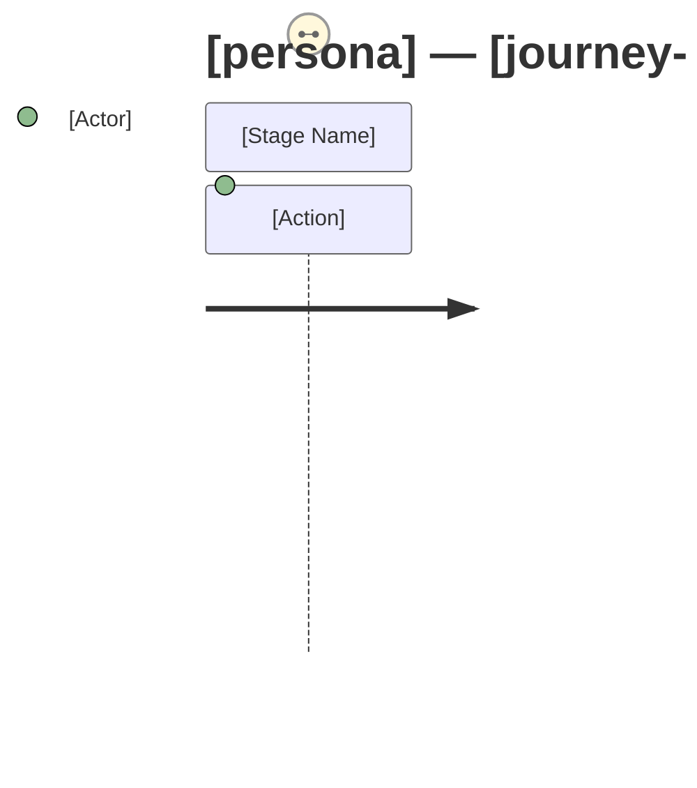

# User Journey Map: [persona] — [journey-name]

> **State:** To-be (future state after the proposed change)
> **Persona:** [Persona name and role]
> **Journey goal:** [What the user wants to accomplish]
> **Date:** [date]
> **Prepared by:** [name]
> **Analysis journey map available:** [Yes — carried forward with updates / No — mapped from user input]
> **Change scope reference:** [link to change-scope item, or "N/A — analysis was skipped"]
> **Process map reference:** [link to to-be process map, or "N/A — analysis was skipped"]

---

## Journey Stages

### [Stage Name] [NEW] / [MODIFIED] / [UNCHANGED]

**User goal:** "I want to..."
**Touchpoints:** [Pages, screens, notifications the user interacts with]
**Actions:** [What the user does — specific and observable]
**System response:** [What the user sees or receives in response]
**Anticipated friction:**
- [Friction point] — Severity: High / Medium / Low
**Satisfaction indicator:** [Positive / Neutral / Negative / Blocked] — [basis: Positive = smooth, no High friction, addresses a known user need; Neutral = workable, no High friction; Negative = at least one High-severity friction point; Blocked = two or more High-severity friction points or one likely to cause abandonment]

---

## Journey Diagram (Mermaid)

---

## Change Delta

| Change Type | Stage | Description | Driving Requirement |
|------------|-------|-------------|---------------------|
| NEW | | | REQ-xxx |
| MODIFIED | | | REQ-xxx |
| REMOVED | (former stage) | | |
| IMPROVED | | [Existing friction resolved] | |

---

## Anticipated Friction Summary

| Stage | Friction Point | Severity | Mitigation |
|-------|---------------|----------|------------|
| | | High / Medium / Low | |

---

## Gaps Requiring Resolution

| Gap | Stage | Priority | Question for Stakeholder |
|-----|-------|----------|------------------------|
| | | Critical / Important / Nice-to-know | |

---

## Cross-Persona Hand-off Points

A hand-off point is any stage where one persona's journey ends and another's begins, or where two personas interact with the same system object at the same time.

| Hand-off | From Persona / Stage | To Persona / Stage | Consistent? | Issue (if any) |
|----------|---------------------|--------------------|-------------|----------------|
| [hand-off name] | [persona] / [stage] | [persona] / [stage] | [Yes / No] | [data / timing / state inconsistency — or "None"] |

*If this journey involves only one persona with no hand-offs, write: Single-persona journey — no cross-persona hand-off points.*

---

## Assumptions

| # | Assumption | Impact if Wrong |
|---|-----------|----------------|
| 1 | [assumption about the journey] | [consequence] |

*If analysis ran, write: Journey carried forward from analysis phase — no new assumptions introduced.*
