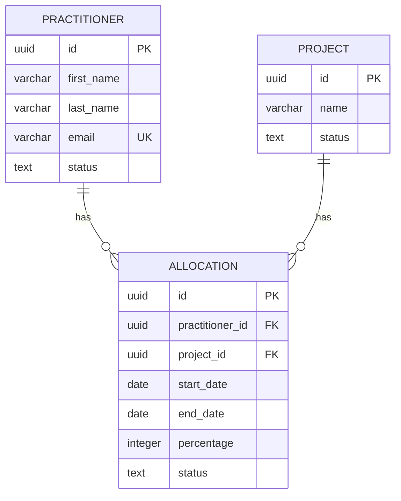
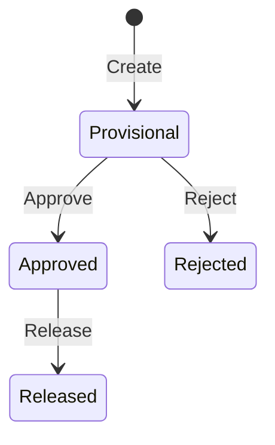

# [Project Name] — Solution Design Package

> **Purpose of this document:** This solution design package defines HOW the system will be built, translating business requirements into technical specifications. It serves as the technical blueprint that drives implementation and provides persistent context for AI-assisted code generation.
>
> **What this document is NOT:** This is not the Requirements Package. Business objectives, functional requirements, business rules, stakeholder definitions, and acceptance criteria belong in the Requirements Package. This document specifies the technical approach to implementing those requirements.
>
> **Upstream dependency:** This document is driven by the Requirements Package located at `[path/to/docs/requirements/]`. Every design decision should trace back to one or more requirements.
>
> **Documentation version:** [e.g., 1.0.0]
> **Project name:** [e.g., ResourceHub]
> **Last updated:** [date]

---

## Table of Contents

### Part 1 — Overview & Strategy
1. [Solution Overview](#1-solution-overview)
2. [Technology Stack](#2-technology-stack)
3. [Solution Architecture](#3-solution-architecture)

### Part 2 — Frontend Design
4. [Frontend Design](#4-frontend-design)

### Part 3 — Backend Design
5. [Backend Design](#5-backend-design)
6. [API Design](#6-api-design)

### Part 4 — Data Layer
7. [Database Design](#7-database-design)

### Part 5 — Cross-Cutting Concerns
8. [Security Design](#8-security-design)
9. [Integration Design](#9-integration-design)
10. [Workflow & Business Rules Design](#10-workflow--business-rules-design)

### Part 6 — User Interface
11. [Dashboard & Reporting Design](#11-dashboard--reporting-design)
12. [UX Design](#12-ux-design)

### Part 7 — Operations
13. [Deployment & DevOps](#13-deployment--devops)
14. [Observability & Operations](#14-observability--operations)

### Part 8 — Quality
15. [Testing Strategy](#15-testing-strategy)
16. [Non-Functional Requirements (Technical)](#16-non-functional-requirements-technical)

### Part 9 — Reference
17. [Risk Assessment](#17-risk-assessment)
18. [Glossary & Acronyms](#18-glossary--acronyms)

---

# Part 1 — Overview & Strategy

---

## 1. Solution Overview

<!-- Executive-level view of the solution, bridging from business context to technical approach. This is the master document that ties everything together. -->

### 1.1 Executive Summary

<!-- Brief technical summary: what we're building, core technical approach, and key design decisions. Written for technical stakeholders. -->

[2-3 paragraphs summarizing the technical solution, its architecture, and how it addresses the business requirements.]

### 1.2 Business Context & Problem Statement

<!-- Brief recap from Requirements — enough context so this document stands on its own when loaded into an AI session. -->

- **Business Problem:** [One sentence from requirements]
- **Solution:** [One sentence describing the system]
- **Key Users:** [List primary personas from requirements]

### 1.3 Solution Vision & Scope

<!-- What the solution encompasses at a high level. -->

**In-Scope Capabilities:**

| # | Capability | Requirement Reference |
|---|-----------|----------------------|
| 1 | [e.g., Practitioner profile management] | FR1.1 |
| 2 | [e.g., Resource allocation workflow] | FR3.1 |
| | | |

**Explicitly Out of Scope:**

- [e.g., Mobile native application]
- [e.g., Third-party integrations beyond SSO]

### 1.4 High-Level Navigation / User Experience

<!-- Information architecture — what major areas exist and how they relate. Not UI design, but the conceptual structure. -->

```
[Application]
├── Dashboard (role-specific)
├── [Area 1, e.g., People]
│   ├── List View
│   └── Detail View
├── [Area 2, e.g., Projects]
│   ├── List View
│   └── Detail View
├── [Area 3, e.g., Allocations]
└── [Area 4, e.g., Administration]
```

### 1.5 Data Ownership & Source of Truth

<!-- Define where authoritative data lives. Critical for integration decisions. -->

| Data | Source of Truth | Notes |
|------|----------------|-------|
| [e.g., User identity] | [e.g., Microsoft Entra ID] | [e.g., JIT provisioned into local DB] |
| [e.g., Employee details] | [e.g., HR System] | [e.g., Synced nightly] |
| [e.g., Allocations] | [e.g., This system] | [e.g., Authoritative source] |

### 1.6 Assumptions, Constraints & Out of Scope

<!-- Technical assumptions and constraints that shape design decisions. -->

**Technical Assumptions:**
- [e.g., All users have modern browsers with JavaScript enabled]
- [e.g., Network latency to Azure services < 50ms]

**Technical Constraints:**
- [e.g., Must use corporate-approved technology stack]
- [e.g., Must deploy to Azure cloud]
- [e.g., Database must be managed PostgreSQL service]

---

## 2. Technology Stack

<!-- Actionable, implementation-ready technology decisions with pinned versions. This document is THE reference for all technology choices — other design documents reference this. -->

### 2.1 Pinned Versions (Baseline)

<!-- Pin major versions to ensure consistency across all design documents and implementation. -->

```
[Language]: [Version]
[Framework]: [Version]
[Database]: [Version]
[Runtime]: [Version]
```

### 2.2 Frontend Technologies

| Category | Technology | Version | Purpose |
|----------|-----------|---------|---------|
| Language | [e.g., TypeScript] | [e.g., 5.x] | [e.g., Type-safe development] |
| Framework | [e.g., React] | [e.g., 18.2.0] | [e.g., UI component framework] |
| Routing | [e.g., React Router] | [e.g., 6.x] | [e.g., Client-side routing] |
| State Management | [e.g., TanStack Query + Context] | [e.g., 5.x] | [e.g., Server state + app state] |
| UI Components | [e.g., shadcn/ui + Tailwind CSS] | [e.g., latest] | [e.g., Design system] |
| Build Tool | [e.g., Vite] | [e.g., 5.x] | [e.g., Development server and bundler] |
| Testing | [e.g., Vitest + Playwright] | [versions] | [e.g., Unit + E2E testing] |

### 2.3 Backend Technologies

| Category | Technology | Version | Purpose |
|----------|-----------|---------|---------|
| Language | [e.g., Java] | [e.g., 21] | [e.g., Backend development] |
| Framework | [e.g., Spring Boot] | [e.g., 3.5.9] | [e.g., Application framework] |
| ORM | [e.g., Spring Data JPA / Hibernate] | [version] | [e.g., Database access] |
| Migrations | [e.g., Flyway] | [version] | [e.g., Schema versioning] |
| Testing | [e.g., JUnit 5 + Testcontainers] | [versions] | [e.g., Unit + integration testing] |

### 2.4 Database Technologies

| Category | Technology | Version | Purpose |
|----------|-----------|---------|---------|
| RDBMS | [e.g., PostgreSQL] | [e.g., 16] | [e.g., Primary data store] |
| Hosting | [e.g., Azure Database for PostgreSQL] | [e.g., Flexible Server] | [e.g., Managed service] |

### 2.5 Infrastructure & Hosting

| Category | Technology | Purpose |
|----------|-----------|---------|
| Cloud | [e.g., Microsoft Azure] | [e.g., Hosting platform] |
| Compute | [e.g., Azure Container Apps] | [e.g., Application runtime] |
| Identity | [e.g., Microsoft Entra ID] | [e.g., SSO and user management] |
| CI/CD | [e.g., GitHub Actions] | [e.g., Build and deployment pipeline] |

### 2.6 Standards & Conventions

| Standard | Specification | Usage |
|----------|--------------|-------|
| [e.g., API Errors] | [e.g., RFC 7807 Problem Details] | [e.g., All API error responses] |
| [e.g., API Documentation] | [e.g., OpenAPI 3.0] | [e.g., API contract specification] |
| [e.g., Accessibility] | [e.g., WCAG 2.1 AA] | [e.g., All user-facing interfaces] |
| [e.g., Date/Time] | [e.g., ISO 8601] | [e.g., All date/time fields in API and DB] |

---

## 3. Solution Architecture

<!-- High-level architecture and system design. This shapes the structure of the entire codebase. -->

### 3.1 Architecture Overview

<!-- One paragraph describing the overall architecture approach and rationale. -->

[e.g., "The system follows a modular monolith architecture with a React SPA frontend communicating with a Spring Boot REST API backend. PostgreSQL serves as the primary data store. Authentication is delegated to Microsoft Entra ID via OAuth2/OIDC."]

### 3.2 Architectural Drivers

<!-- Requirements that most influence architecture decisions. Reference specific FRs and NFRs. -->

| Driver | Requirement | Architecture Implication |
|--------|-----------|------------------------|
| [e.g., Concurrent users: 100] | [NFR-Perf-1] | [e.g., Stateless API, connection pooling] |
| [e.g., SSO required] | [FR1.9.1] | [e.g., OAuth2 Resource Server configuration] |
| | | |

### 3.3 System Context Diagram

<!-- C4 Level 1 — shows the system as a box and its relationships with users and external systems. Use Mermaid or ASCII. -->

```
[System Context Diagram]

┌─────────────┐     ┌──────────────────┐     ┌─────────────┐
│   Users     │────▶│  [System Name]   │────▶│ External    │
│ (Browser)   │◀────│  (Web App + API) │◀────│ Systems     │
└─────────────┘     └──────────────────┘     └─────────────┘
                           │
                           ▼
                    ┌──────────────┐
                    │  Database    │
                    └──────────────┘
```

### 3.4 High-Level Architecture Diagram

<!-- C4 Level 2 — shows containers (frontend, backend, database) and their interactions. -->

```
[Container Diagram]

┌──────────────────────────────────────────────────┐
│                   Client Browser                  │
│  ┌─────────────────────────────────────────┐     │
│  │         [Frontend SPA]                   │     │
│  │  (React / Angular / Vue)                 │     │
│  └──────────────┬──────────────────────────┘     │
└─────────────────┼────────────────────────────────┘
                  │ HTTPS / REST
                  ▼
┌──────────────────────────────────────────────────┐
│              [Backend API]                        │
│  ┌───────────┐ ┌───────────┐ ┌───────────┐     │
│  │Controller │→│ Service   │→│Repository │     │
│  │  Layer    │ │  Layer    │ │  Layer    │     │
│  └───────────┘ └───────────┘ └─────┬─────┘     │
└────────────────────────────────────┼────────────┘
                                     │ SQL
                                     ▼
                              ┌──────────────┐
                              │  [Database]  │
                              │ (PostgreSQL) │
                              └──────────────┘
```

### 3.5 Component Architecture

<!-- How the system is organized internally — modules, feature slices, or layers. -->

[Describe the internal component organization and boundaries.]

### 3.6 Deployment Architecture

<!-- How components are deployed in each environment. -->

[Describe hosting, containers, networking, load balancing.]

### 3.7 Architecture Principles & Patterns

<!-- Key architectural principles guiding design decisions. -->

| Principle | Description | Example |
|-----------|------------|---------|
| [e.g., Layered Architecture] | [e.g., Strict separation of concerns: Controller → Service → Repository] | [e.g., Controllers never access repositories directly] |
| [e.g., Single Responsibility] | [e.g., Each service handles one domain area] | [e.g., AllocationService handles only allocation logic] |
| | | |

---

# Part 2 — Frontend Design

---

## 4. Frontend Design

<!-- Technical design for the web frontend. Covers architecture, state management, routing, and all frontend-specific concerns. -->

### 4.1 Frontend Architecture Overview

[One paragraph describing the frontend approach, framework, and key patterns.]

### 4.2 Technology Baseline

[Reference Technology Stack document section 2.2. Summarize key frontend technologies here.]

### 4.3 Application Structure

<!-- Folder organization and module structure. -->

```
src/
├── components/        # Shared/reusable components
├── features/          # Feature-based modules
│   ├── [feature-a]/
│   │   ├── components/
│   │   ├── hooks/
│   │   ├── api/
│   │   └── types/
│   └── [feature-b]/
├── layouts/           # Page layouts
├── hooks/             # Shared hooks
├── services/          # API services
├── types/             # Shared types
├── utils/             # Utility functions
└── config/            # Configuration
```

### 4.4 Routing

<!-- Route definitions and navigation structure. -->

| Route | Component | Auth Required | Roles |
|-------|----------|:---:|-------|
| [e.g., /] | [e.g., Dashboard] | Yes | [e.g., All] |
| [e.g., /practitioners] | [e.g., PractitionerList] | Yes | [e.g., Admin, Resource Manager] |
| [e.g., /practitioners/:id] | [e.g., PractitionerDetail] | Yes | [e.g., Admin, Resource Manager] |
| | | | |

### 4.5 State Management Strategy

<!-- How application and server state are managed. -->

| State Type | Technology | Usage |
|-----------|-----------|-------|
| [e.g., Server State] | [e.g., TanStack Query] | [e.g., API data fetching, caching, invalidation] |
| [e.g., Application State] | [e.g., React Context] | [e.g., User session, theme, sidebar state] |
| [e.g., Form State] | [e.g., React Hook Form] | [e.g., Form inputs, validation] |
| [e.g., URL State] | [e.g., React Router] | [e.g., Filters, pagination, active tabs] |

### 4.6 API Integration

<!-- How the frontend communicates with the backend. -->

- **HTTP Client:** [e.g., Axios / fetch wrapper]
- **Base URL Configuration:** [e.g., Environment-specific API base URL]
- **Authentication Header:** [e.g., Bearer token in Authorization header]
- **Error Handling:** [e.g., Global error interceptor, RFC 7807 error parsing]
- **Data Freshness:** [e.g., TanStack Query stale time: 30s, refetch on window focus]

### 4.7 Authentication (Frontend)

<!-- How SSO and token management work on the frontend. -->

- **SSO Flow:** [e.g., MSAL redirect flow → Entra ID → token returned → stored in memory]
- **Token Storage:** [e.g., In-memory only (not localStorage)]
- **Token Refresh:** [e.g., Silent refresh via MSAL]
- **Logout:** [e.g., Clear token + redirect to Entra ID logout]

### 4.8 Authorization (Frontend)

<!-- How RBAC is enforced in the UI. -->

- **Role Source:** [e.g., JWT claims from /api/me endpoint]
- **Route Guards:** [e.g., Role-based route protection via wrapper component]
- **Component Visibility:** [e.g., Conditional rendering based on user role]

### 4.9 Environment Configuration

<!-- How different environments are configured. -->

| Variable | Development | Staging | Production |
|----------|-----------|---------|------------|
| [e.g., API_BASE_URL] | [e.g., http://localhost:8080] | [e.g., https://api-staging.example.com] | [e.g., https://api.example.com] |
| [e.g., ENTRA_CLIENT_ID] | [value] | [value] | [value] |

### 4.10 Browser Support & Accessibility

- **Browsers:** [e.g., Chrome, Firefox, Safari, Edge — latest 2 versions]
- **Accessibility Standard:** [e.g., WCAG 2.1 AA]
- **Responsive:** [e.g., Desktop-first, responsive down to 1024px]

### 4.11 Frontend Testing Strategy

| Test Type | Framework | Coverage Target | Focus |
|-----------|----------|----------------|-------|
| [e.g., Unit Tests] | [e.g., Vitest] | [e.g., 80%] | [e.g., Hooks, utilities, business logic] |
| [e.g., Component Tests] | [e.g., Testing Library] | [e.g., Key components] | [e.g., Render, interaction, accessibility] |
| [e.g., E2E Tests] | [e.g., Playwright] | [e.g., Critical paths] | [e.g., Login, CRUD workflows, navigation] |

### 4.12 Frontend Performance

- [e.g., Code splitting by route (lazy loading)]
- [e.g., Image optimization]
- [e.g., Memoization of expensive computations]
- [e.g., Virtualization for long lists]

---

# Part 3 — Backend Design

---

## 5. Backend Design

<!-- Technical design for the backend API. Covers architecture, service patterns, and backend-specific concerns. -->

### 5.1 Backend Architecture Overview

[One paragraph describing the backend approach, framework, and key patterns.]

### 5.2 Layered Architecture

<!-- Define the layers and their responsibilities. -->

| Layer | Responsibility | Example Classes |
|-------|---------------|----------------|
| [e.g., Controller] | [e.g., HTTP handling, request/response mapping, validation] | [e.g., PractitionerController] |
| [e.g., Service] | [e.g., Business logic, orchestration, transaction management] | [e.g., PractitionerService] |
| [e.g., Repository] | [e.g., Data access, queries, persistence] | [e.g., PractitionerRepository] |
| [e.g., Domain/Entity] | [e.g., Data model, entity definitions] | [e.g., Practitioner, Allocation] |

**Rules:**
- [e.g., Controllers never access repositories directly]
- [e.g., Services never handle HTTP concerns]
- [e.g., Repositories never contain business logic]

### 5.3 Domain Model

<!-- Key entities and their relationships in the backend. -->

[Describe the domain model — entities, value objects, and how they map to database tables.]

### 5.4 Service Layer Design

<!-- Patterns for service classes. -->

- **Transaction Management:** [e.g., @Transactional on service methods, not controllers]
- **Validation:** [e.g., Bean Validation on DTOs, business validation in services]
- **Error Handling:** [e.g., Services throw domain exceptions, global handler maps to RFC 7807]

### 5.5 API Conventions

<!-- REST API conventions that apply across all endpoints. -->

- **Naming:** [e.g., kebab-case URLs, camelCase JSON]
- **Pagination:** [e.g., ?page=0&size=20, response includes totalElements, totalPages]
- **Filtering:** [e.g., Query parameters: ?status=ACTIVE&search=keyword]
- **Sorting:** [e.g., ?sort=lastName,asc]
- **Error Format:** [e.g., RFC 7807 Problem Details]

### 5.6 Backend Testing Strategy

| Test Type | Framework | Focus |
|-----------|----------|-------|
| [e.g., Unit Tests] | [e.g., JUnit 5 + Mockito] | [e.g., Service logic, validation rules] |
| [e.g., Integration Tests] | [e.g., @SpringBootTest + Testcontainers] | [e.g., API endpoints, database operations] |

---

## 6. API Design

<!-- REST API contracts and endpoint specifications. This section defines the external contract that frontend and consumers integrate with. -->

### 6.1 API Overview

- **Base URL:** [e.g., /api]
- **Authentication:** [e.g., Bearer token (Entra ID JWT)]
- **Content Type:** [e.g., application/json]
- **Error Format:** [e.g., RFC 7807 application/problem+json]

### 6.2 API Versioning Strategy

[e.g., URL path versioning (/api/v1/), header versioning, or no versioning for internal APIs.]

### 6.3 Common Response Patterns

#### Success Response
```json
{
  "id": "uuid",
  "field1": "value",
  "createdAt": "2026-01-01T00:00:00Z"
}
```

#### Paginated Response
```json
{
  "content": [...],
  "totalElements": 100,
  "totalPages": 5,
  "page": 0,
  "size": 20
}
```

#### Error Response (RFC 7807)
```json
{
  "type": "about:blank",
  "title": "Bad Request",
  "status": 400,
  "detail": "Validation failed",
  "instance": "/api/practitioners",
  "errors": [...]
}
```

### 6.4 Endpoint Specifications

<!-- Document each endpoint by domain area. For each endpoint: method, path, description, auth, request, response, errors. -->

#### [Domain Area, e.g., Practitioners API]

##### [Method] [Path]

**Description:** [What this endpoint does]
**Authorization:** [Required role(s)]
**Implements:** [FR reference(s)]

**Request:**
```json
{
  "field1": "value (required)",
  "field2": "value (optional)"
}
```

**Response (200/201):**
```json
{
  "id": "uuid",
  "field1": "value"
}
```

**Error Responses:**

| Status | Type | When |
|--------|------|------|
| 400 | Validation Error | [e.g., Required field missing] |
| 401 | Unauthorized | [e.g., No/invalid token] |
| 403 | Forbidden | [e.g., Insufficient role] |
| 404 | Not Found | [e.g., Resource doesn't exist] |
| 409 | Conflict | [e.g., Duplicate entry] |

<!-- Repeat for each endpoint in this domain area, then repeat the domain area section for each area. -->

---

# Part 4 — Data Layer

---

## 7. Database Design

<!-- Technical design for the database layer. Translates data requirements from the Requirements Package into schema specifications. -->

### 7.1 Database Architecture Overview

- **RDBMS:** [e.g., PostgreSQL 16]
- **Hosting:** [e.g., Azure Database for PostgreSQL — Flexible Server]
- **Schema:** [e.g., public (single schema)]

### 7.2 Schema Design Conventions

<!-- Naming and structure conventions that apply to all tables. -->

| Convention | Rule | Example |
|-----------|------|---------|
| Table Names | [e.g., snake_case, singular] | [e.g., practitioner, allocation] |
| Column Names | [e.g., snake_case] | [e.g., first_name, created_at] |
| Primary Keys | [e.g., UUID, column name: id] | [e.g., id UUID DEFAULT gen_random_uuid()] |
| Foreign Keys | [e.g., referenced_table_id] | [e.g., practitioner_id UUID REFERENCES practitioner(id)] |
| Timestamps | [e.g., TIMESTAMPTZ, auto-populated] | [e.g., created_at, updated_at] |
| Status Fields | [e.g., TEXT with CHECK constraint] | [e.g., status TEXT CHECK (status IN ('ACTIVE', 'INACTIVE'))] |

### 7.3 Common Columns

<!-- Standard columns included in all or most tables. -->

| Column | Type | Description | Default |
|--------|------|------------|---------|
| [e.g., id] | [e.g., UUID] | [Primary key] | [e.g., gen_random_uuid()] |
| [e.g., created_at] | [e.g., TIMESTAMPTZ] | [Record creation timestamp] | [e.g., CURRENT_TIMESTAMP] |
| [e.g., updated_at] | [e.g., TIMESTAMPTZ] | [Last update timestamp] | [e.g., CURRENT_TIMESTAMP] |
| [e.g., created_by] | [e.g., UUID] | [User who created the record] | |
| [e.g., version] | [e.g., INTEGER] | [Optimistic locking version] | [e.g., 0] |

### 7.4 Core Tables

<!-- Define each table with its columns, constraints, and indexes. -->

#### [Table Name, e.g., practitioner]

**Purpose:** [e.g., Stores practitioner profiles]
**Implements:** [e.g., FR1.1]

| Column | Type | Nullable | Default | Constraints | Description |
|--------|------|:---:|---------|------------|-------------|
| [e.g., id] | [UUID] | No | [gen_random_uuid()] | [PK] | [Primary key] |
| [e.g., first_name] | [VARCHAR(100)] | No | | | [Legal first name] |
| [e.g., email] | [VARCHAR(255)] | No | | [UNIQUE] | [Corporate email, case-insensitive] |
| [e.g., status] | [TEXT] | No | ['ACTIVE'] | [CHECK IN ('ACTIVE','INACTIVE')] | [Record status] |
| | | | | | |

**Indexes:**

| Index Name | Columns | Type | Purpose |
|-----------|---------|------|---------|
| [e.g., idx_practitioner_email] | [e.g., LOWER(email)] | [e.g., UNIQUE] | [e.g., Case-insensitive email uniqueness] |
| | | | |

<!-- Repeat for each core table -->

### 7.5 Entity Relationship Diagram

<!-- Use Mermaid syntax for version-controllable ERD. -->



### 7.6 Migration Strategy

- **Tool:** [e.g., Flyway]
- **Naming Convention:** [e.g., V{version}__{description}.sql — e.g., V001__create_practitioner_table.sql]
- **Location:** [e.g., src/main/resources/db/migration/]
- **Rules:** [e.g., Migrations are append-only, never modify existing migrations]

### 7.7 Indexing Strategy

[Describe the overall indexing approach — what gets indexed and why.]

### 7.8 Data Retention & Archival

[Describe retention policies and archival approach.]

---

# Part 5 — Cross-Cutting Concerns

---

## 8. Security Design

<!-- Security architecture and implementation decisions. -->

### 8.1 Security Overview

[One paragraph describing the overall security approach.]

### 8.2 Authentication Strategy

- **Method:** [e.g., OAuth2/OIDC via Microsoft Entra ID]
- **Flow:** [e.g., Authorization Code Flow with PKCE (frontend) → JWT Bearer (API)]
- **Token Type:** [e.g., Entra ID JWT access token]
- **Token Lifetime:** [e.g., 1 hour, silent refresh via MSAL]

### 8.3 Authorization Model (RBAC)

<!-- How roles and permissions are enforced. -->

**Role Source:** [e.g., Entra ID app roles, mapped from JWT `roles` claim]

**Role Definitions:**

| Role | Entra ID App Role | System Permissions |
|------|-------------------|-------------------|
| [e.g., Administrator] | [e.g., App.Admin] | [e.g., Full CRUD on all entities, user management] |
| [e.g., Resource Manager] | [e.g., App.ResourceManager] | [e.g., Manage practitioners and allocations] |
| | | |

### 8.4 Data Security

| Concern | Approach |
|---------|---------|
| [e.g., Encryption at rest] | [e.g., Azure-managed encryption (TDE)] |
| [e.g., Encryption in transit] | [e.g., TLS 1.2+ enforced] |
| [e.g., PII handling] | [e.g., Minimize collection, encrypt sensitive fields] |
| [e.g., Audit logging] | [e.g., All data modifications logged with user, timestamp, action] |

### 8.5 Security Headers

| Header | Value | Purpose |
|--------|-------|---------|
| [e.g., Content-Security-Policy] | [value] | [e.g., Prevent XSS] |
| [e.g., X-Content-Type-Options] | [nosniff] | [e.g., Prevent MIME sniffing] |
| [e.g., Strict-Transport-Security] | [value] | [e.g., Force HTTPS] |

---

## 9. Integration Design

<!-- External system integrations and their technical specifications. -->

### 9.1 Integration Overview

| System | Direction | Protocol | Purpose |
|--------|-----------|----------|---------|
| [e.g., Microsoft Entra ID] | [Bidirectional] | [OAuth2/OIDC] | [e.g., SSO authentication] |
| [e.g., SMTP Server] | [Outbound] | [SMTP/TLS] | [e.g., Email notifications] |
| | | | |

### 9.2 [Integration Name] Integration

**Purpose:** [What this integration does]
**Protocol:** [How they communicate]
**Authentication:** [How the systems authenticate to each other]
**Error Handling:** [What happens when the integration fails]
**Retry Strategy:** [How failures are retried]

<!-- Repeat for each integration -->

---

## 10. Workflow & Business Rules Design

<!-- How business rules from Requirements translate to system behavior. -->

### 10.1 State Machines

<!-- Technical implementation of state transitions from Requirements. -->

#### [Entity] State Machine



**Transition Rules:**

| From | To | Action | Required Role | Side Effects |
|------|-----|--------|--------------|-------------|
| [Provisional] | [Approved] | [Approve] | [Resource Manager] | [e.g., Notify requester, update availability] |
| | | | | |

### 10.2 Business Rule Implementation

<!-- Map business rules from Requirements to technical implementation. -->

| Rule (from Requirements) | Implementation Approach | Location |
|-------------------------|------------------------|----------|
| [e.g., BR1.1 — Allocation 1-100%] | [e.g., Bean Validation @Min(1) @Max(100)] | [e.g., CreateAllocationRequest DTO] |
| [e.g., BR1.2 — No duplicate allocations] | [e.g., Service layer check before save] | [e.g., AllocationService.create()] |
| | | |

---

# Part 6 — User Interface

---

## 11. Dashboard & Reporting Design

<!-- Information architecture and data visualization for dashboards. -->

### 11.1 [Role Name] Dashboard

**Key Metrics:**

| Metric | Source | Visualization | Refresh Rate |
|--------|--------|--------------|-------------|
| [e.g., Pending Approvals] | [e.g., GET /api/allocations?status=PROVISIONAL&count=true] | [e.g., Badge/Counter] | [e.g., On page load + 30s polling] |
| | | | |

**Primary Views:**
- [e.g., Pending approvals list with quick-action buttons]
- [e.g., Team utilization bar chart for next 4 weeks]

<!-- Repeat for each role's dashboard -->

---

## 12. UX Design

<!-- User experience specifications that guide frontend implementation. -->

### 12.1 Design System

- **Component Library:** [e.g., shadcn/ui]
- **Styling Framework:** [e.g., Tailwind CSS]
- **Color Palette:** [Define primary, secondary, success, warning, error colors]
- **Typography:** [Define font family, sizes, weights]

### 12.2 Navigation Patterns

[Describe sidebar, top nav, breadcrumbs, and navigation behavior.]

### 12.3 Responsive Design

| Breakpoint | Width | Layout |
|-----------|-------|--------|
| [e.g., Desktop] | [e.g., ≥ 1280px] | [e.g., Sidebar + content] |
| [e.g., Tablet] | [e.g., ≥ 1024px] | [e.g., Collapsible sidebar] |
| | | |

### 12.4 User Flows

<!-- Detailed interaction flows for key workflows. Use step-by-step descriptions, not wireframes. -->

#### [Flow Name, e.g., Create Allocation Request]

1. [e.g., User navigates to Projects → selects project → clicks "Request Resource"]
2. [e.g., Form appears with: Practitioner (searchable dropdown), Start/End dates, Percentage]
3. [e.g., System validates in real-time: availability check, over-allocation warning]
4. [e.g., User submits → success toast → redirects to allocation detail view]

---

# Part 7 — Operations

---

## 13. Deployment & DevOps

### 13.1 Environment Strategy

| Environment | Purpose | URL | Deployment |
|------------|---------|-----|-----------|
| [e.g., Development] | [e.g., Active development] | [e.g., localhost] | [e.g., Local Docker Compose] |
| [e.g., Staging] | [e.g., Pre-production testing] | [e.g., staging.example.com] | [e.g., Auto-deploy on merge to main] |
| [e.g., Production] | [e.g., Live system] | [e.g., app.example.com] | [e.g., Manual approval gate] |

### 13.2 CI/CD Pipeline

[Describe the build, test, and deployment pipeline stages.]

### 13.3 Container Strategy

[Describe Dockerfiles, image registry, container orchestration.]

### 13.4 Rollback Strategy

[How to roll back a failed deployment.]

---

## 14. Observability & Operations

### 14.1 Logging Strategy

| Level | When to Use | Example |
|-------|-----------|---------|
| [ERROR] | [Unrecoverable failures] | [e.g., Database connection lost] |
| [WARN] | [Recoverable issues] | [e.g., Retry succeeded after failure] |
| [INFO] | [Significant business events] | [e.g., Allocation approved] |
| [DEBUG] | [Diagnostic details] | [e.g., Query parameters, response times] |

### 14.2 Metrics & Monitoring

| Metric | Source | Alert Threshold |
|--------|--------|----------------|
| [e.g., API response time P95] | [e.g., Application metrics] | [e.g., > 2 seconds] |
| [e.g., Error rate] | [e.g., Log aggregation] | [e.g., > 1% of requests] |
| | | |

### 14.3 Health Checks

| Endpoint | Checks | Used By |
|----------|--------|---------|
| [e.g., /actuator/health] | [e.g., Database connectivity, disk space] | [e.g., Load balancer, monitoring] |

---

# Part 8 — Quality

---

## 15. Testing Strategy

### 15.1 Testing Pyramid

| Level | Quantity | Speed | Focus |
|-------|---------|-------|-------|
| [Unit Tests] | [Many] | [Fast] | [Individual functions, services, components] |
| [Integration Tests] | [Moderate] | [Medium] | [API endpoints, database operations] |
| [E2E Tests] | [Few] | [Slow] | [Critical user journeys] |

### 15.2 Test Environment Strategy

| Environment | Database | External Services | Data |
|------------|----------|------------------|------|
| [e.g., Unit Tests] | [e.g., Mocked] | [e.g., Mocked] | [e.g., In-memory fixtures] |
| [e.g., Integration Tests] | [e.g., Testcontainers PostgreSQL] | [e.g., Mocked/WireMock] | [e.g., Test fixtures] |
| [e.g., E2E Tests] | [e.g., Staging DB copy] | [e.g., Staging services] | [e.g., Seeded test data] |

### 15.3 Test Data Management

[How test data is created, maintained, and cleaned up.]

---

## 16. Non-Functional Requirements (Technical)

<!-- Technical specifications for non-functional requirements from the Requirements Package. -->

### 16.1 Performance Targets

| Metric | Target | Measurement | Requirement Ref |
|--------|--------|-------------|----------------|
| [e.g., Page load] | [e.g., < 2s] | [e.g., Lighthouse score] | [NFR-1] |
| [e.g., API P95 latency] | [e.g., < 500ms] | [e.g., APM monitoring] | [NFR-2] |
| | | | |

### 16.2 Scalability Design

[How the system scales to meet growth requirements.]

### 16.3 Availability Design

- **Target SLA:** [e.g., 99.5%]
- **Approach:** [e.g., Azure-managed HA for database, multiple container instances]
- **Maintenance Windows:** [e.g., Sundays 2-6 AM]

---

# Part 9 — Reference

---

## 17. Risk Assessment

| # | Risk | Likelihood | Impact | Mitigation |
|---|------|-----------|--------|-----------|
| 1 | [e.g., Entra ID integration complexity] | [Medium] | [High] | [e.g., Spike implementation in Phase 0] |
| 2 | [e.g., Database performance under load] | [Low] | [High] | [e.g., Load testing in staging, indexing strategy] |
| | | | | |

---

## 18. Glossary & Acronyms

### Business Terms

| Term | Definition |
|------|-----------|
| [e.g., Allocation] | [e.g., The assignment of a practitioner to a project] |
| | |

### Technical Terms

| Term | Definition |
|------|-----------|
| [e.g., JWT] | [JSON Web Token — encoded token for authentication] |
| [e.g., RBAC] | [Role-Based Access Control] |
| | |

### Acronyms

| Acronym | Expansion |
|---------|-----------|
| [e.g., SSO] | [Single Sign-On] |
| [e.g., OIDC] | [OpenID Connect] |
| | |

---

## Document Relationships

<!-- How solution design documents reference each other and trace to requirements. -->

```
Requirements Package
    │
    ├──→ 01-Solution Overview (maps all FRs to design areas)
    │
    ├──→ 02-Technology Stack (referenced by all other design docs)
    │
    ├──→ 03-Architecture (shapes 04-07)
    │       │
    │       ├──→ 04-Frontend Design
    │       ├──→ 05-Backend Design
    │       ├──→ 06-API Design
    │       └──→ 07-Database Design
    │
    ├──→ 08-Security Design (cross-cutting, referenced by 04-07)
    │
    ├──→ 09-Integration Design
    │
    ├──→ 10-Workflow Design (implements business rules from Requirements)
    │
    └──→ 13-Deployment → 14-Observability → 15-Testing
```
